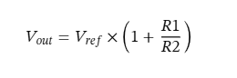
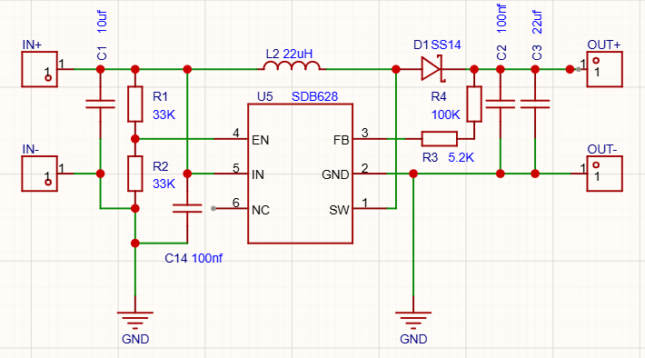

# mini-step-up-circuit-diagram
Step up dengan ic db628 rentang input 1-22v dan output fixed dengan resistor divider (contoh 12.14v)

cara hitung output dari sinyal PWM(Pulse Width Modulation) dengan resistor

Skema Diagram

